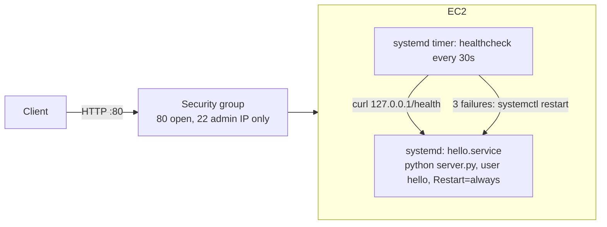

# Architecture / request path

Request: client -> internet -> security group (allows tcp/80) -> instance -> python process (non-root, bound via CAP_NET_BIND_SERVICE).
Reboot: systemd starts `hello.service` and `healthcheck.timer` (both enabled by cloud-init).
